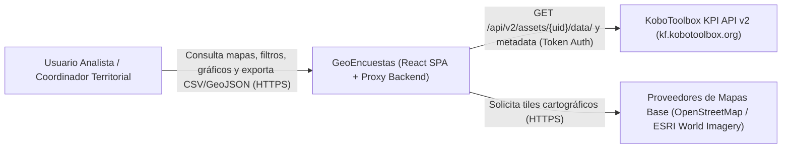
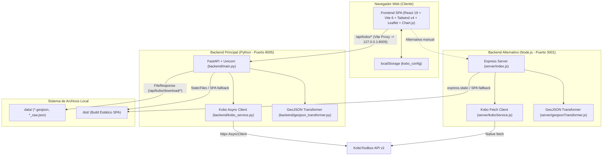
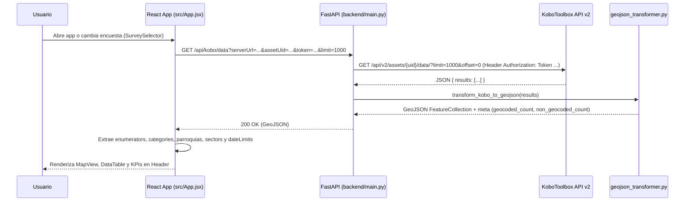

# Arquitectura del Sistema — GeoEncuestas

Este documento describe la arquitectura real implementada en el repositorio `gob_encuesta`, incluyendo diagramas C4 en Mermaid, flujos críticos de datos, topología de despliegue y Registro de Decisiones de Arquitectura (ADRs).

---

## 1. Vista de Contexto (C4 Nivel 1)

---

## 2. Vista de Contenedores (C4 Nivel 2)

---

## 3. Vista de Componentes Frontend (C4 Nivel 3)

```mermaid
flowchart TD
    App["src/App.jsx (Estado Global, Config, Filtros, Pipelines useMemo)"]
    Api["src/services/api.js (Cliente HTTP /api/kobo)"]
    Filters["src/utils/formattersAndFilters.js (Pipeline de Filtros y KPIs)"]
    Exporters["src/utils/exporters.js (Exportación GeoJSON y CSV)"]

    Header["Header.jsx (Selector Encuesta, Tabs, KPIs)"]
    Sidebar["Sidebar.jsx (Filtros y Exportación)"]
    MapView["MapView.jsx (Leaflet, Pines, Bounds Sync)"]
    DataTable["DataTable.jsx (Tabla Paginada y Ordenable)"]
    Dashboard["DashboardView.jsx (Chart.js y Distribuciones)"]
    Detail["RecordDetail.jsx (Drawer de Ficha Completa)"]
    Config["ConfigModal.jsx (Credenciales y Test Conexión)"]

    App --> Api
    App --> Filters
    App --> Exporters
    App --> Header
    App --> Sidebar
    App --> MapView
    App --> DataTable
    App --> Dashboard
    App --> Detail
    App --> Config
```

---

## 4. Flujos Clave del Sistema

### 4.1 Flujo de Carga y Transformación Geoespacial

### 4.2 Flujo de Sincronización Espacial (Bounding Box)

1. El usuario mueve o hace zoom sobre el mapa en `src/components/MapView.jsx`.
2. Los eventos `moveend` / `zoomend` disparan `emitBounds()`, que valida que el contenedor no tenga dimensiones `0x0` y llama `onBoundsChange({ south, west, north, east })`.
3. `src/App.jsx` ejecuta dos pipelines memoizados (`useMemo`):
   - `attributeFilteredFeatures`: aplica búsqueda de texto, rango de fechas, encuestador, parroquia, sector y categoría (alimenta `MapView`, `DashboardView` y `Header` KPIs).
   - `tableFilteredFeatures`: toma `attributeFilteredFeatures` y, si `spatialFilterEnabled && mapBounds && mobileSplitView !== 'table'`, aplica `filterFeaturesByBounds()` (alimenta `DataTable` y los exportadores CSV/GeoJSON).

---

## 5. Topología de Despliegue

### Desarrollo Local
- **Frontend**: `npm run dev` ejecuta Vite en `0.0.0.0:5173` con proxy configurado en `vite.config.js` redirigiendo `/api/*` a `http://127.0.0.1:8005`.
- **Backend Principal**: `npm run server` ejecuta Uvicorn (`backend.main:app`) en `0.0.0.0:8005` con `--reload`.
- **Backend Alternativo**: `node server/index.js` levanta Express en `PORT` (por defecto `3001`).

### Producción Monolítica (SPA servida por Backend)
1. Ejecutar `npm run build` para generar el bundle estático en `dist/` con chunks separados (`vendor`, `leaflet`, `charts`).
2. Ejecutar FastAPI (`uvicorn backend.main:app --host 0.0.0.0 --port 8005`) o Express (`node server/index.js`). Ambos detectan `dist/` y sirven `index.html` con fallback SPA para rutas no `/api/*`.

---

## 6. Registro de Decisiones de Arquitectura (ADRs)

| ADR | Decisión | Contexto y Justificación | Consecuencias / Trade-offs |
| :--- | :--- | :--- | :--- |
| **ADR-001** | **Backend Proxy para KoboToolbox API v2** | Evita restricciones CORS directas del navegador hacia `kf.kobotoolbox.org` y centraliza la normalización de geopoints a GeoJSON estándar. | Introduce un salto HTTP adicional; actualmente coexisten dos implementaciones (`backend/` FastAPI y `server/` Express) que deben mantenerse alineadas o consolidarse en una sola. |
| **ADR-002** | **FastAPI como backend por defecto en Vite** | `vite.config.js` y `package.json` (`npm run server`) apuntan a FastAPI en el puerto `8005`, aprovechando `httpx` asíncrono, validación Pydantic y OpenAPI automático (`/docs`). | El servidor Express (`server/index.js`) queda como alternativa secundaria y diverge levemente (ej. modo demo automático y ausencia de `/api/kobo/download/{filename}`). |
| **ADR-003** | **Filtrado y Analítica en Cliente (`useMemo`)** | Los datasets actuales rondan los 500–610 envíos por encuesta (`limit=1000`), por lo que filtrar en memoria en React ofrece latencia instantánea al mover el mapa (Bounding Box) o cambiar filtros. | Si el volumen supera ~5,000–10,000 registros por formulario, se requerirá paginación/filtrado espacial en servidor (PostGIS) y clustering real en Leaflet. |
| **ADR-004** | **Transformación GeoJSON tolerante a esquemas heterogéneos** | KoboToolbox puede devolver coordenadas en `_geolocation` (lista), `start-geopoint` (string `"lat lon alt prec"`) u otros campos dinámicos. `find_geopoint` inspecciona claves conocidas y luego hace fallback heurístico. | Alta resiliencia ante cambios de formulario, aunque con riesgo de falsos positivos si un campo de texto no geográfico contiene dos números separados por espacio. |
| **ADR-005** | **Sin Base de Datos Relacional Propia** | KoboToolbox actúa como fuente de verdad externa, complementado con snapshots locales en `data/` (`download_kobo_data.py`) y `localStorage` para configuración de sesión. | Cero costo operativo de base de datos, pero sin historial de auditoría, sin caché distribuida y dependiente de la disponibilidad de la API externa. |

