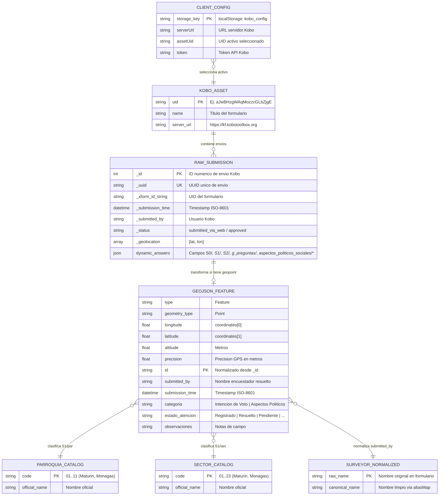

# Modelo de Datos — GeoEncuestas

> **Nota de Veracidad Arquitectónica**: Este repositorio **no utiliza un motor de base de datos relacional (SQL) ni NoSQL tradicional**. La persistencia y el modelo de datos se estructuran en torno a tres capas reales:
> 1. **Fuente Externa**: Formularios y envíos de **KoboToolbox KPI API v2**.
> 2. **Snapshots Locales**: Archivos estáticos JSON/GeoJSON generados en [`data/`](../data/) mediante [`download_kobo_data.py`](../download_kobo_data.py).
> 3. **Estado en Cliente**: Configuración persistida en `localStorage` bajo la clave `kobo_config`.

---

## 1. Diagrama Entidad-Relación Lógico (ERD)

---

## 2. Esquema de Salida GeoJSON (`FeatureCollection`)

Generado por [`backend/geojson_transformer.py`](../backend/geojson_transformer.py) (`transform_kobo_to_geojson`) y [`server/geojsonTransformer.js`](../server/geojsonTransformer.js) (`transformKoboToGeoJSON`):

| Campo | Tipo | Obligatorio | Descripción |
| :--- | :--- | :---: | :--- |
| `type` | `string` | Sí | Literal `"FeatureCollection"`. |
| `features` | `Array<Feature>` | Sí | Lista de envíos que poseen coordenadas GPS válidas. |
| `features[].type` | `string` | Sí | Literal `"Feature"`. |
| `features[].geometry.type` | `string` | Sí | Literal `"Point"`. |
| `features[].geometry.coordinates` | `[number, number]` | Sí | Par `[longitude, latitude]` conforme a RFC 7946. |
| `features[].properties.id` | `number \| string` | Sí | Derivado de `_id`, `id` o fallback `sub_{n}`. |
| `features[].properties.uuid` | `string \| null` | No | Derivado de `_uuid` o `uuid`. |
| `features[].properties.submitted_by` | `string` | Sí | Resuelto en orden de prioridad: `S0/_xm_s0_nombreapellido`, `S0/nombre_apellido`, `S0/nombre_encuestador`, `encuestador`, `_submitted_by`, `submitted_by`, `"Encuestador Anónimo"`. |
| `features[].properties.submission_time` | `string (ISO-8601)` | Sí | Fecha/hora de envío (`_submission_time`). |
| `features[].properties.status` | `string` | Sí | Estado del registro (`_status`, fallback `"submitted"`). |
| `features[].properties.latitude` | `number` | Sí | Latitud decimal. |
| `features[].properties.longitude` | `number` | Sí | Longitud decimal. |
| `features[].properties.altitude` | `number` | Sí | Altitud en metros (default `0.0`). |
| `features[].properties.precision` | `number` | Sí | Precisión horizontal GPS en metros (default `0.0`). |
| `features[].properties.categoria` | `string` | Sí | Determinada dinámicamente (`"Intención de Voto"` o `"Aspectos Políticos"`, o categoría explícita). |
| `features[].properties.estado_atencion` | `string` | Sí | Estado operativo (default `"Registrado"`). |
| `features[].properties.observaciones` | `string` | Sí | Texto libre de observaciones (default `""`). |
| `features[].properties.*` | `any` | No | Se preservan todos los campos originales del envío KoboToolbox (`**item` / `...item`). |
| `meta.total` | `number` | Sí | Total de registros crudos recibidos. |
| `meta.geocoded_count` | `number` | Sí | Registros con geopoint válido incluidos en `features`. |
| `meta.non_geocoded_count` | `number` | Sí | Registros descartados por carecer de coordenadas válidas. |
| `meta.limit` | `number` | Sí | Límite aplicado en la consulta. |
| `meta.offset` | `number` | Sí | Desplazamiento aplicado en la consulta. |
| `meta.timestamp` | `string (ISO-8601)` | Sí | Instante UTC de transformación. |

---

## 3. Esquemas de Instrumentos KoboToolbox Activos

### 3.1 Campos Comunes (Demográficos y Territoriales)

| Clave Kobo | Etiqueta Humana | Tipo / Dominio |
| :--- | :--- | :--- |
| `S0/cedula_encuestador` | Cédula Encuestador | `string` numérico |
| `S0/_xm_s0_nombreapellido` / `S0/nombre_apellido` | Nombre Encuestador | `string` (normalizado vía `normalizeSurveyorName`) |
| `S1/par` | Parroquia (Código) | Catálogo `PARROQUIA_NAMES` (`01` a `11`, Maturín, Monagas) |
| `S1/sec` | Sector (Código) | Catálogo `SECTOR_NAMES` (`01` a `23`, Maturín, Monagas) |
| `S2/sexo` | Sexo | `1_masculino`, `2_femenino` |
| `S2/edad` | Edad | Entero agrupado en `18-29`, `30-44`, `45-59`, `60+` |
| `g_filtro/inscrito_registro` | Inscrito en CNE | `1` (Sí), `2` (No) |

### 3.2 Instrumento 1: Intención de Voto y Clima Electoral (`aJwBHzgWAqMozzcGLbZjgE`)

- **Snapshot local**: [`data/intencion_de_voto.geojson`](../data/intencion_de_voto.geojson) (`594` registros totales, `505` geolocalizados, `89` sin coordenadas).
- **Campos analizados** (en `DashboardView.jsx` y `recordDetailHelpers.js`):
  - `g_preguntas/g_propension/si_elecciones_domingo`
  - `g_preguntas/g_preferencia/si_hoy_tarjeta_electoral`
  - `g_preguntas/g_identificación/tendencia_politica`
  - `g_preguntas/g_percibido/cual_candidato_cree`
  - `g_preguntas/g_motivacion/principal_motivacion`
  - `g_preguntas/g_clima/propaganda`
  - `g_preguntas/g_transparencia/nivel_confianza`
  - `g_preguntas/g_voto/cambio_voto`
  - `g_preguntas/g_animo/animo`

### 3.3 Instrumento 2: Aspectos Políticos y Sociales (`ajgQTzZcCG3ccEuB8dvNZc`)

- **Snapshot local**: [`data/aspectos_politicos_y_sociales.geojson`](../data/aspectos_politicos_y_sociales.geojson) (`607` registros totales, `496` geolocalizados, `111` sin coordenadas).
- **Campos analizados**:
  - `aspectos_politicos_sociales/g_gestion/gestion`
  - `aspectos_politicos_sociales/g_infraestructura/infraestructura`
  - `aspectos_politicos_sociales/g_servicios_publicos/servicios_publicos`
  - `aspectos_politicos_sociales/g_salud/salud`
  - `aspectos_politicos_sociales/g_desarrollo_economico/desarrollo_economico`
  - `aspectos_politicos_sociales/g_seguridad/seguridad`
  - `aspectos_politicos_sociales/g_programas_sociales/programas_sociales`
  - `aspectos_politicos_sociales/g_transparencia/transparencia`
  - `aspectos_politicos_sociales/g_participación_ciudadana/participación_ciudadana`
  - `aspectos_politicos_sociales/g_aprobacion/aprobacion`

---

## 4. Archivos de Datos Locales (`data/`)

| Archivo | Formato | Propósito |
| :--- | :--- | :--- |
| `data/intencion_de_voto_raw.json` | JSON crudo Kobo API v2 | Respaldo íntegro sin transformar |
| `data/intencion_de_voto.geojson` | GeoJSON FeatureCollection | Snapshot transformado para descarga/análisis |
| `data/aspectos_politicos_y_sociales_raw.json` | JSON crudo Kobo API v2 | Respaldo íntegro sin transformar |
| `data/aspectos_politicos_y_sociales.geojson` | GeoJSON FeatureCollection | Snapshot transformado para descarga/análisis |

---

## 5. Modelo de Datos Simulados (Mock Data)

Implementado en [`backend/mock_data.py`](../backend/mock_data.py) y [`server/mockData.js`](../server/mockData.js) para pruebas y demostraciones:
- Genera puntos alrededor del Área Metropolitana de Caracas (`base_lat = 10.475`, `base_lon = -66.890`) distribuidos en 4 municipios (`Libertador`, `Sucre`, `Chacao`, `Baruta`), 7 categorías (`Infraestructura`, `Salud`, `Educación`, `Seguridad`, `Vialidad`, `Agua y Sanidad`, `Alumbrado Público`) y 4 estados (`Resuelto`, `En Proceso`, `Inspección Requerida`, `Pendiente`).
- Incluye `"is_mock": true` en el objeto `meta`.

